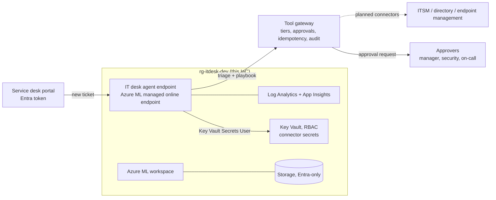

# Deployment to Microsoft Foundry / Azure ML (written, not run)

Nothing here has been deployed. The IaC is checked in CI (`terraform validate` and `test` with mocked
providers, `tflint`, `checkov`, `bicep build`), and the deploy workflow is switched off.

## Target design

The endpoint runs the same code as the local eval. Today its tools act on the simulated systems in
`itdesk/systems.py`. Real connectors (ITSM, directory, endpoint management) are planned work: each one
would replace one method of `Systems` and keep the gateway in front of it.

| Resource | Terraform | Bicep |
|---|---|---|
| Log Analytics + Application Insights | `azurerm_*` | same ARM types |
| Storage (TLS 1.2, no shared keys, no public blobs) | `azurerm_storage_account` | `Microsoft.Storage/storageAccounts` |
| Key Vault (RBAC, purge protection) for connector secrets | `azurerm_key_vault` | `Microsoft.KeyVault/vaults` |
| Endpoint identity -> Key Vault Secrets User (read only) | `azurerm_role_assignment` | `roleAssignments` |
| Azure ML workspace (identity access to storage) | `azapi_resource` (2025-06-01) | `workspaces@2025-06-01` |
| Managed online endpoint (`AADToken`) | `azapi_resource` | `onlineEndpoints@2025-06-01` |
| Diagnostic settings (workspace, Key Vault) | `azurerm_monitor_diagnostic_setting` | `diagnosticSettings` |

`infra/aml/score.py` trains the triage classifier from the committed tickets at start-up (no pickled
model) and calls `itdesk.service.handle`. It is unit-tested offline (`tests/test_service.py`).

## Cost before anyone says yes

Prices from the Azure Retail Prices API, pay-as-you-go, eastus2, checked 2026-11-09:

| Item | Price | 730-hour month |
|---|---|---|
| Endpoint VM, Standard_DS2_v2 Linux, 1 instance | $0.114 per hour | about $83 |

About **$83 per month** always-on, plus small Log Analytics, storage and Key Vault charges. The main
configuration does not call a language model, so there is no model bill. The hybrid triage option
would add a small model deployment in the Foundry catalog, billed separately and not in this IaC.
Delete the resource group to stop charges. Check current prices and get approval before enabling the
workflow.

## One-time setup (only if approved)

1. Entra app registration with a federated credential for this repo's `dev` environment.
2. Contributor on one resource group.
3. Repository variables `AZURE_CLIENT_ID`, `AZURE_TENANT_ID`, `AZURE_SUBSCRIPTION_ID`.
4. A required reviewer on the `dev` environment.
5. `DEPLOY_ENABLED=true`, then run **deploy** by hand. The smoke test sends a privileged access
   request with no change reference and expects `denied`.

## Planned, not built

Real ITSM, directory and endpoint connectors behind the gateway; approvals through a chat or e-mail
workflow instead of the simulator; private endpoints and a VNet; a prod stage; a teardown workflow;
and re-running this eval against the deployed endpoint.
