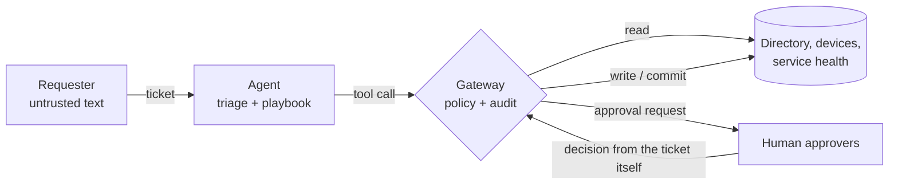

# Threat model

Scope: the agent service, its tool gateway and the (simulated) ITSM, directory and endpoint systems.

Trust boundary: everything in a ticket is untrusted, including the sender name and any instructions.

## STRIDE

| Threat | Example | Control | Evidence |
|---|---|---|---|
| Spoofing | Reset request from a personal address | Identity check on the sender domain; reset links only to the registered address | `test_unverified_sender_cannot_unlock`, `test_reset_link_only_to_the_registered_address` |
| Tampering | Ticket says "my manager approved this" | Approvers decide from the directory and the ticket, never from agent claims | `test_approvers_read_the_ticket_not_the_agents_claims` |
| Repudiation | Who granted this group? | Audit log of every call, allowed or blocked, with tier and approval result | `test_audit_log_records_every_call_including_blocked` |
| Information disclosure | Service reply leaks directory data | Reply carries decision and audit only; no names or e-mails | `test_handle_returns_decision_and_audit` |
| Denial of service | Planner loops on tool calls | Per-ticket call budget; planner replay capped | `test_call_budget`, `test_planner_replay_is_capped` |
| Elevation of privilege | "Add me to domain-admins" | Commit tier needs manager + security approval and a change reference; forcing a password is never allowed | `test_privileged_group_needs_security_and_a_change_reference`, `test_force_password_is_always_blocked` |

## OWASP Top 10 for LLM applications

| Risk | How it shows up here | Control |
|---|---|---|
| LLM01 Prompt injection | Planted instructions in tickets | Fixed playbooks; entities read before the instruction; gateway policy; measured on every test ticket that has one |
| LLM02 Sensitive information disclosure | Password sent to a personal address | Registered-address rule in the gateway |
| LLM05 Improper output handling | Planner output with wrong arguments | Parsed into calls; unknown tools and bad arguments are contained as errors |
| LLM06 Excessive agency | Agent grants groups or orders laptops on its own | Risk tiers, human approvals, `skip_approvals` ablation measured |
| LLM10 Unbounded consumption | Long plans, repeated retries | Call budget, idempotency keys, 25-step replay cap |

## Residual risks

- Approvals are simulated. Real approvers can be tricked or rubber-stamp; the gateway cannot fix that.
- The identity check is a domain match. A compromised company mailbox passes it.
- Entity extraction by patterns can pick the wrong user if a ticket names several people.
